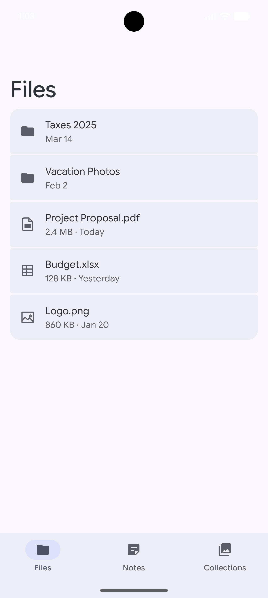
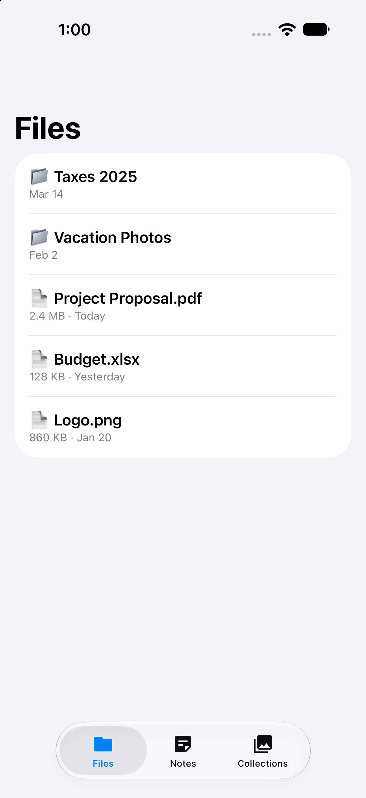
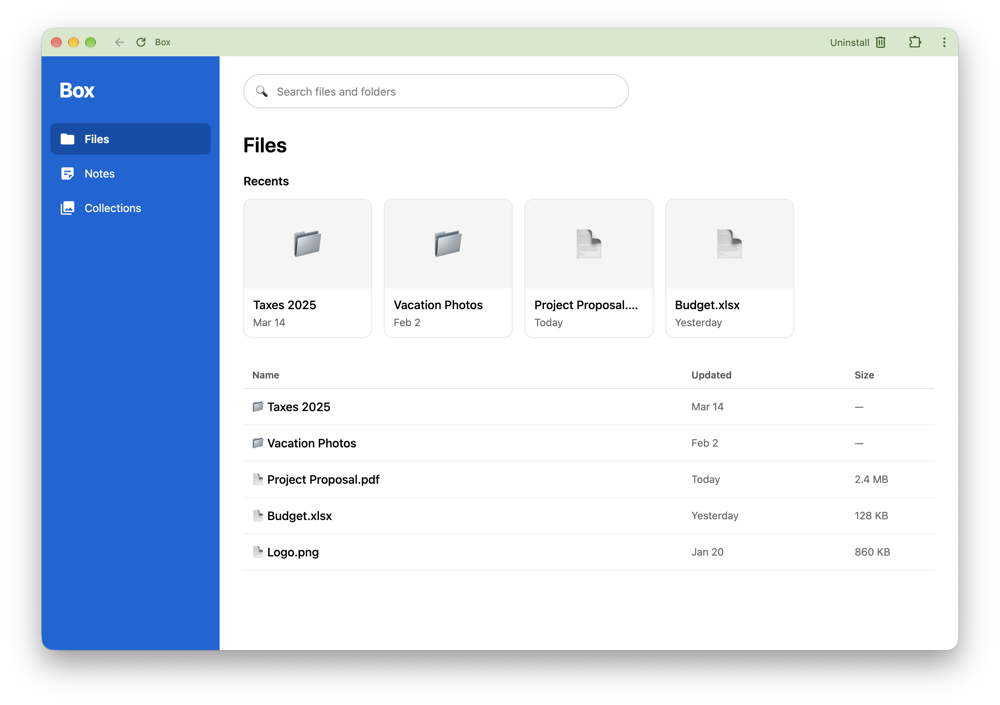
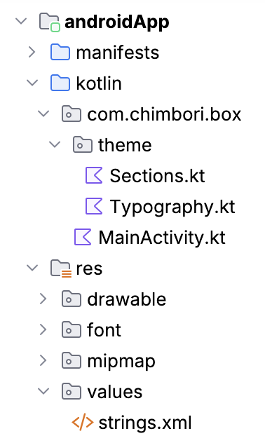
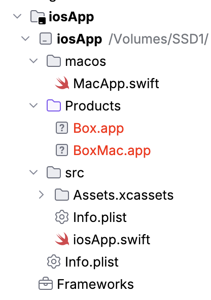
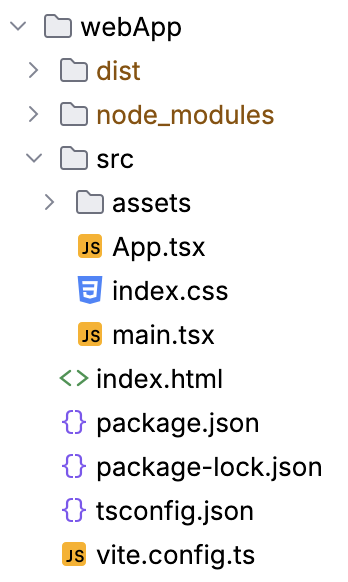
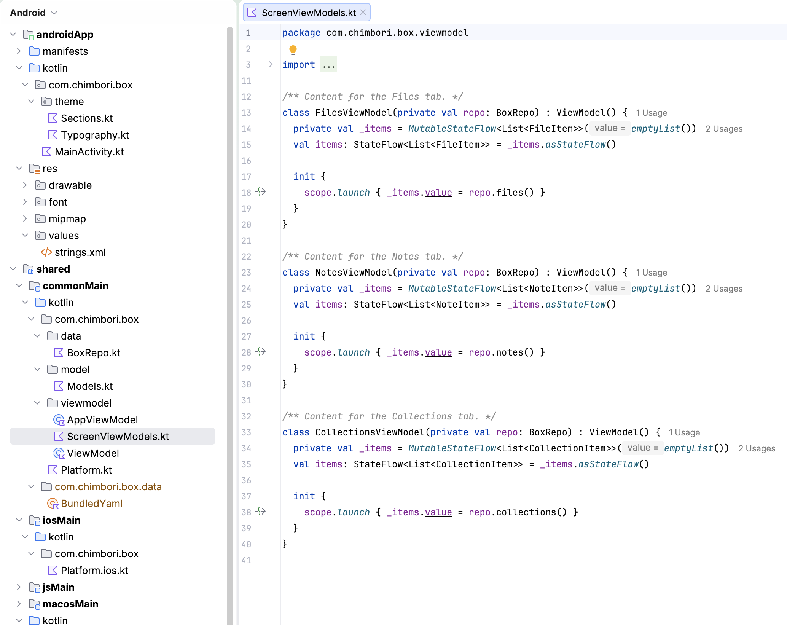

# Box

Kotlin Multiplatform project with shared code for Android, iOS, macOS, and the web.

## Screenshots

All widgets are platform native: SwiftUI on iOS and macOS, Jetpack Compose on Android, and React on the web. The shared layer supplies only state and actions, so each platform renders its own widgets. The iOS video below shows the native Liquid Glass look as proof.

<video src="docs/video-ios-liquid-glass.mp4" controls width="320"></video>

| Android | iOS | Web |
|---------|-----|-----|
|  The Android app on Material 3 Expressive, with native Compose cards and the bottom navigation bar. |  The iOS app with a native SwiftUI list and the Liquid Glass tab bar. |  The web app in a browser, with the blue sidebar on the left, Recents cards, and a file table. |

| Android | iOS | Web |
|---------|-----|-----|
|  The Android app's Kotlin sources, with Compose screens and the Sections theme under `theme/`. |  The iOS app's SwiftUI sources under `iosApp/`, which bind to the shared ViewModels. |  The React web app under `webApp/`, which uses the shared JS library and Tailwind for styling. |

## Architecture

The ViewModels in `shared/` hold all UI state and logic, and every platform binds to them.
Each top-level tab (Files, Notes, Collections) has its own ViewModel, since their code is largely independent,
and the bottom tab list itself comes from a shared Repo and ViewModel.

All ViewModels read their data from the Repo layer in `shared/`. For this prototype, the Repo loads
hard-coded YAML files from `shared/src/commonMain/yaml/` (`tabs`, `files`, `notes`, `collections`).
In a real implementation, this layer would be replaced by a shared network client that fetches the same data at runtime.
The UI layer on each platform stays thin: SwiftUI on iOS and macOS, Jetpack Compose on Android, and React on Web.

## Running

[Task](https://taskfile.dev) runs each platform from `Taskfile.yml`:

- `task android`: install and launch the Android app on a connected device or emulator.
- `task ios`: build and launch the iOS app in the Simulator.
- `task macos`: build and launch the macOS app.
- `task apple`: run `ios` and `macos` in parallel.
- `task web`: start the web dev server.
- `task preview`: run Android and Apple in parallel, then start the web dev server last so it keeps running.

The root `settings.gradle.kts` and `build.gradle.kts` are the Gradle build entry points, and the
project uses the Gradle wrapper (`./gradlew`), so no separate Gradle install is needed.

Build the whole project with `./gradlew build`.

## Modules

- [/androidApp](./androidApp) contains the Android application. Run it with `./gradlew :androidApp:installDebug`.
- [/webApp](./webApp) contains the React web app, which uses the JS build of `:shared`. Run it with `task web`, which builds the shared library, installs npm dependencies, and starts Vite on port 8081.
- [/iosApp](./iosApp) contains the iOS and macOS applications, built with Xcode. Open `iosApp/iosApp.xcodeproj`. The Xcode build phase invokes `./gradlew :shared:embedAndSignAppleFrameworkForXcode`.
- [/shared](./shared) holds the code shared across the applications. [src/commonMain](./shared/src/commonMain)
  is for common code; the sibling `src/<platform>Main` folders (for example `src/androidMain`) hold
  code compiled only for that platform.
- Shared layers: `model/` holds data classes, `data/` holds the `BoxRepo` interface and `YamlBoxRepo`, and
  `viewmodel/` holds ViewModels that drive all UI. Per-tab ViewModels are separate per screen. The prototype's
  data comes from [yaml](./shared/src/commonMain/yaml) files, bundled into Kotlin at build time. A real
  implementation would replace `YamlBoxRepo` with a network-backed repo.
- The JS target exports TypeScript definitions for use in React apps. Build them with
  `./gradlew :shared:jsBrowserProductionLibrary`, which writes
  `shared/build/dist/js/productionLibrary/Box-shared.d.ts`.
